<div align="center">
  <picture>
    <source media="(prefers-reduced-motion: reduce)" srcset="docs/readme/banner-still.webp">
    
  </picture>
  <br><br>
  
  <br><br>
  <p><strong>A cinematic restaurant site with no build step.</strong><br>
  <sub>Eight scroll-scrubbed signatures · a server-checked order bag · a reviewed WhatsApp handoff<br>
  table requests with private status links · an owner desk that runs the whole house.</sub></p>
  <p>
    <a href="#quick-start"><strong>Run it</strong></a> ·
    <a href="#the-experience">Tour</a> ·
    <a href="#order-without-a-checkout">Ordering</a> ·
    <a href="#the-house-desk">Owner desk</a> ·
    <a href="#deploy">Deploy</a> ·
    <a href="#docs">Docs</a>
  </p>
</div>

<p align="center">
  <picture>
    <source media="(prefers-reduced-motion: reduce)" srcset="docs/readme/demo-still.webp">
    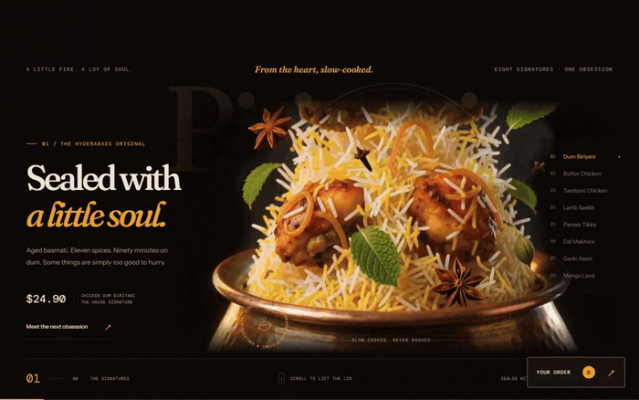
  </picture>
  <br>
  <sub><strong>THE EIGHT SIGNATURES</strong> — a real capture of the running site, not a mockup.</sub>
</p>


## The experience

The first screen is a table that keeps unfolding. The hero pins while eight signature dishes pass through — each with its own film, its own headline and its own price. The index on the right tells you where you are. Films blob-load in order, play only near the viewport and pause when they leave it.

Past the hero: the dum story, the eleven whole spices, the full menu, a charcoal tandoor sequence, the house rules and the visit. The page is built as one continuous film, not a stack of cards.

Buildless on purpose. HTML, CSS and vanilla JavaScript. GSAP/ScrollTrigger **3.12.5** and Lenis **1.1.13** come from CDNs; type comes from Google Fonts (Fraunces, Instrument Sans, DM Mono). There is no framework, bundler or `npm install`.

<p align="center">
  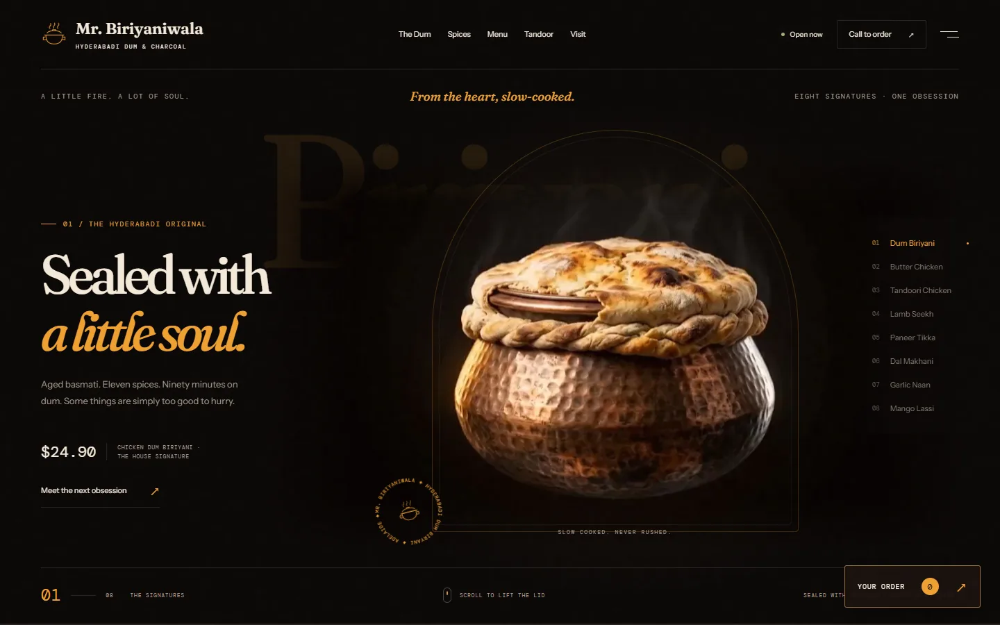 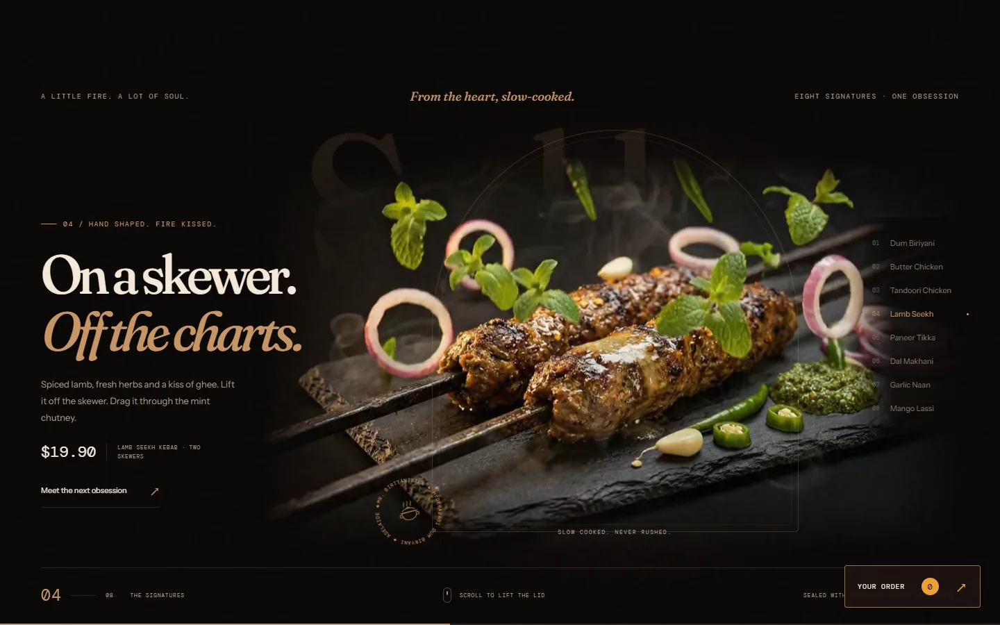
  <br>
  <sub>One pinned hero, eight films. The right-hand index tracks the current signature.</sub>
</p>


## One house. Three doors.

<p align="center">
  
</p>

A guest can browse and order without an account. The browser keeps the bag on the device. The server re-prices it when the guest reviews, then prepares a WhatsApp draft. Nothing is charged, sent or accepted automatically.

The Node server also owns the live menu, the reservation inbox, the owner dashboard, opt-in measurements and runtime SEO. The static build is a real deployment target, not a demo mode: it keeps the story, full menu, order bag and WhatsApp handoff. Table requests fall back to a call.

| | Static host | `node server.mjs` |
|---|---|---|
| Story, full menu, filters and order bag | Included | Included |
| Server-checked prices and quote refresh | Local estimate only | Included |
| Sold-out dish blocking | Included | Included |
| Reviewed WhatsApp draft | Included | Included |
| Reservation inbox and private status links | Call fallback | Included |
| Owner desk, measurements and runtime SEO | — | Included |


## The menu is the source of truth

Twenty-two dishes across five tabs, with search plus vegetarian and house-special filters. Each dish opens its own order sheet with spice (where offered), extras and quantity. Sold-out dishes are disabled in the menu and blocked again when the order is reviewed.

Prices are quoted by the server. If the menu changed while a bag was open, the review step says so and shows the new total before the guest continues. The eight cinematic signatures cannot be dropped from the catalog, but the owner can mark them sold out.

<p align="center">
  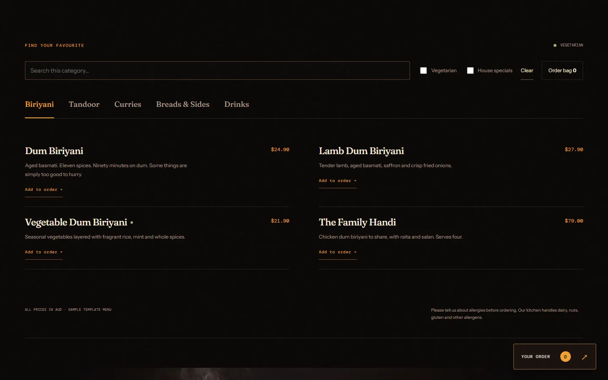
  <br>
  <sub>Twenty-two dishes, five tabs, search and filters — all from one catalog.</sub>
</p>

<p align="center">
  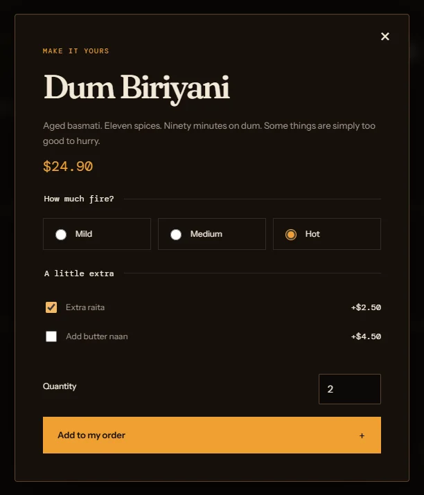
  <br>
  <sub>A dish sheet: heat, extras, quantity — priced before it reaches the bag.</sub>
</p>

## Order, without a checkout

The bag survives refreshes. Quantities, spice, extras and unavailable lines are re-checked on every review. The guest then gets a prepared message for **+92 336 8933584** that they can read, copy or open in WhatsApp themselves.

No payment is taken. No order is sent by the site. No delivery or table is promised until the restaurant confirms. Every one of those rules is also written into the interface.

<p align="center">
  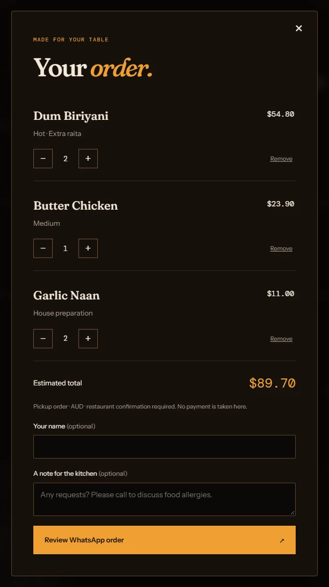
</p>

## Tables with a paper trail

Table requests are real records, not a contact form in disguise. Available times follow the Adelaide opening hours, a 30-minute lead time and a 90-day horizon; they do not claim real-time table inventory.

The owner sees a pending inbox and can confirm, decline or cancel, with private notes. The guest gets a token-protected status link that excludes contact details and owner notes. There are no automated SMS or email notifications — call when a direct reply is needed. Reservation records are kept for up to 90 days. An existing HTTPS booking service can replace the built-in form through Settings.

<p align="center">
  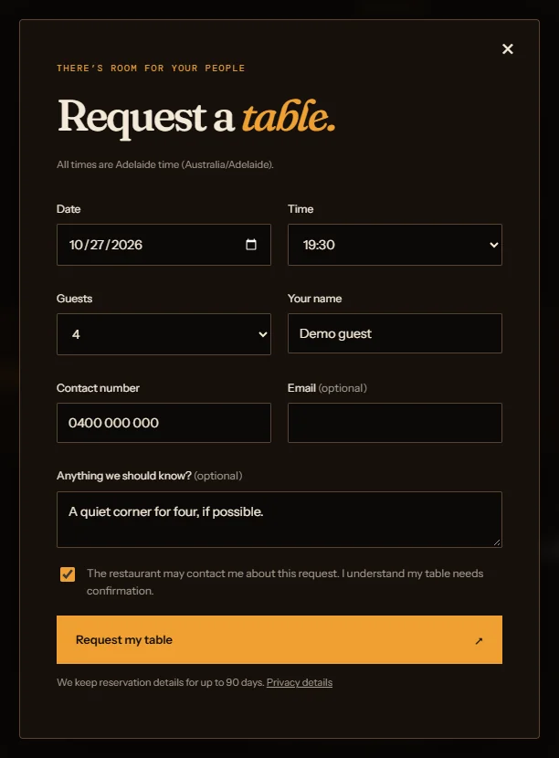
</p>

## The house desk

`/admin.html` is the owner side of the same house: menu prices and descriptions, special labels and prices, vegetarian flags, spice choices, extras, sold-out dishes, opening hours, contact details, Instagram, the final domain, the reservation inbox and opt-in measurements. Menu JSON exports for backup or a static release exclude credentials, reservations and analytics.

Every save writes through a serialized queue with atomic replacement. Concurrent edits return a conflict instead of silently overwriting a newer change. Owner sessions are memory-only and last eight hours, or until restart.

<p align="center">
  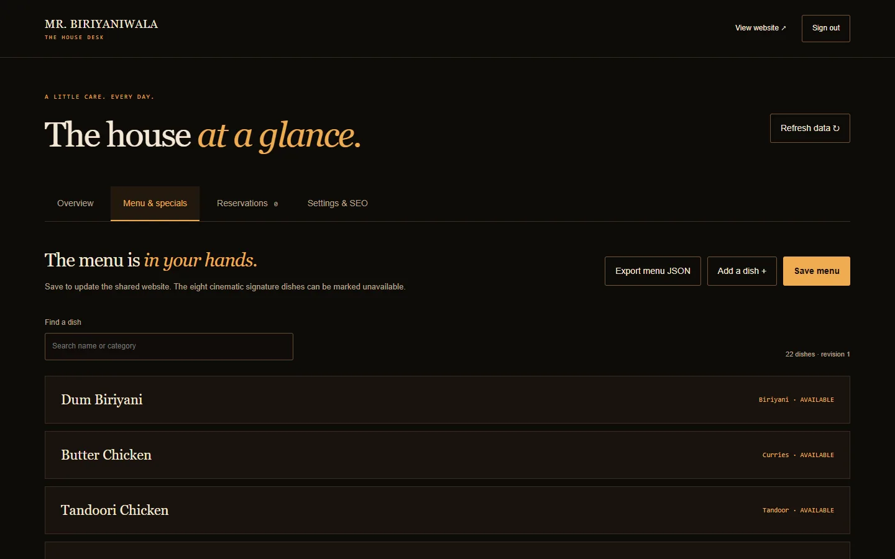
  <br>
  <sub>Captured with isolated demo data. No live credentials or customer records are included.</sub>
</p>

<p align="center">
  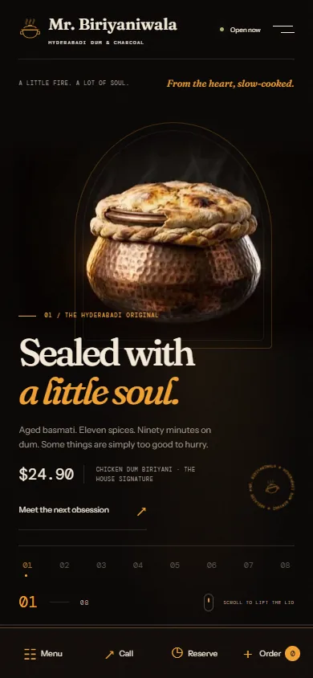
  <br>
  <sub>The same house, in one hand.</sub>
</p>


## Quick start

### 1. Run the whole house

```sh
node server.mjs
```

Use **Node.js 22 or newer**. No packages or build step are required. Open `http://127.0.0.1:4174/`; the owner desk is at `/admin.html`.

On the first local visit, create your own owner password (12–128 characters). There is no default password. The bundled archive contains no owner password or customer records.

The default host is `127.0.0.1`. If you expose the server beyond localhost, set `ADMIN_PASSWORD` first (at least 12 characters); the server refuses to start without it.

### 2. Preview without the server

Serve the folder over HTTP — for example, `npx serve .` — and open the printed address. Use HTTP, not `file://`, because the hero fetches its films as blobs.

Static mode keeps the story, menu, bag and WhatsApp draft. The shared owner desk, live menu, built-in reservations, measurements and runtime SEO need the Node server.

### 3. Run the domain tests

```sh
node --test server/domain.test.mjs
```

The suite covers server-priced extras and specials, unavailable dishes, quantity and spice limits, overnight hours, Adelaide DST gaps, invalid dates, catalog constraints, domain validation and structured data.


## Under the hood

```text
.
├── index.html            public story, menu and dialogs
├── admin.html            owner desk shell
├── css/style.css         brand tokens, layout, motion-safe states
├── js/main.js            SITE / SIGNATURES / MENU defaults, hero engine
├── js/commerce.js        bag, quote, WhatsApp, reservations, measurements
├── server.mjs            zero-dependency static + JSON API server
├── server/               validation, pricing, auth, state, SEO
├── data/catalog.json     seed catalog and static data source
├── media/                films, posters and stills
├── scripts/              media, SEO and packaging helpers
├── docs/                 implementation and operation notes
└── .runtime/             private owner and reservation state — never publish
```

| Layer | What happens |
|---|---|
| Guest UI | Buildless HTML/CSS/JS; GSAP scroll choreography; Lenis smooth scroll |
| Guest state | `localStorage` bag; `sessionStorage` booking token; no guest account |
| Server | Node built-ins only; JSON API; validated catalog; atomic writes |
| Owner access | Salted scrypt password; HttpOnly SameSite session; CSRF and origin checks |
| Data | `.runtime/store.json` and `.runtime/owner.json`; seed in `data/catalog.json` |
| SEO | Runtime head, canonical and JSON-LD on Node; static script for other hosts |

The JSON store is designed for one restaurant and one Node process per data directory, not a clustered deployment. Owner sessions intentionally expire on restart.


## Make it yours

- **Routine changes:** use `/admin.html` for menu, prices, specials, sold-out dishes, extras, hours, contact details and the final domain. Saves appear on the public site after refresh and persist in `.runtime/store.json`.
- **Seed and static data:** `data/catalog.json` is the editable seed and the static site's data source. The Node server reads it only when its runtime store does not exist yet. Export saved menu data from the dashboard and replace this file to update a static release.
- **Story defaults:** in `js/main.js`, `SITE` and `MENU` are the original story defaults, `SIGNATURES` controls the eight hero dishes and their media/accent colors, and `SPICES` plus `HOUSE_RULES` hold their copy. `node scripts/export-catalog.mjs` regenerates the seed from these defaults — only run it intentionally, because it overwrites `data/catalog.json`.
- **Markup and style:** `index.html` holds the brand copy and metadata; `css/style.css` holds color and font tokens at the top, with responsive breakpoints at 1100, 900 and 520px. No branding is baked into the films or images.

Configured contact: **0336 8933584**, WhatsApp **923368933584**, **Jail Road, Heerabad**, **6 pm–2 am daily**. Adelaide branding and `Australia/Adelaide` time are retained at the owner's explicit request. Menu and extras prices remain editable sample AUD prices. Set the Instagram URL in Settings to activate that link; until then it reads “coming soon”. No final domain or external booking service was supplied; the built-in inbox is operational, and previews remain `noindex`.

Overnight hours such as `['18:00', '02:00']` are supported; a missing weekday means closed.

## Media pipeline

Install FFmpeg/FFprobe with libx264 and libwebp, plus Bash (Git Bash on Windows). Put raw renders in `assets/`, matching the filename prefixes in `scripts/process.sh`, then run:

```sh
bash scripts/process.sh
# Rebuild only the replacement biryani:
bash scripts/process.sh biryani-rise
```

Custom binary locations: `FFMPEG=/path/to/ffmpeg FFPROBE=/path/to/ffprobe bash scripts/process.sh`.

The biryani source is `assets/biryan video.mp4`. All source action is retimed into six seconds at 24fps. Hero exports are **1280w / CRF 26** and **720w / CRF 27**, H.264, silent, faststart, with `keyint=2:min-keyint=1:scenecut=0:bframes=0`. The `veryslow` preset and equal I/P quantization (`ipratio=1.0`) avoid spending extra bits on every other frame without reducing keyframe density. Films are 1280w / CRF 26; first-frame JPEG posters are 720w. Ten stills are 1600w WebP quality 82. The current `media/` folder is about **48 MB**.

The lower-right delogo box is normalized to the supplied footage and deliberately wider for inherited sparkle marks. Inspect it when replacing renders. `DELOGO=0` disables cleanup globally; the clean replacement biryani bypasses it. Generation prompts are kept in [`docs/ASSET-PROMPTS.md`](docs/ASSET-PROMPTS.md).

## Deploy

For every feature, deploy the included Node server behind HTTPS with a persistent writable data volume.

| Variable | Purpose |
|---|---|
| `ADMIN_PASSWORD` | Owner password, 12+ characters; required when `HOST` is not localhost |
| `PUBLIC_URL` | Final HTTPS root domain used for canonical URLs and social metadata |
| `HOST` | Bind address; defaults to `127.0.0.1` |
| `PORT` | HTTP port; defaults to `4174` |
| `DATA_DIR` | Persistent data directory; defaults to `.runtime` |

Run **one Node process per data directory**. Menu and reservation data persist across restarts; owner sessions do not.

For static-only hosting, upload:

```text
index.html  privacy.html  robots.txt  sitemap.xml
css/  js/  data/catalog.json  media/
```

Then set the final domain and update the static SEO:

```sh
node scripts/static-seo.mjs https://your-domain.example
```

Use your real domain — do not publish the example domain. The Node server generates these SEO responses directly from Settings.

Keep `.runtime/` private and back it up through your host. Never put it on a static public host or in the template archive. Password hashes and customer data are excluded from the ZIP, along with raw downloads, local tools and QA screenshots.

## Privacy, access and measurement

- **Opt-in only.** No measurement events are sent before consent. Visitors choose in the footer and can change their mind.
- **What is measured.** First-party page visits, menu views, cart additions, call clicks, WhatsApp handoffs, reservation openings and browser performance. Names, phones, emails, order notes and booking details are excluded.
- **Retention.** Measurements are kept for 30 days subject to entry limits; reservations for 90 days. Cleanup runs on writes, on startup and hourly while the server runs. Offline backups need separate retention management.
- **Access.** Password hashing, HttpOnly SameSite sessions, CSRF tokens, origin checks, request-size limits, rate limits, private status tokens, output escaping and a public-file allowlist. Serve production over HTTPS. Behind a reverse proxy, enforce public per-client rate limits at the proxy as well.
- **Reduced motion.** The preference disables smooth scrolling, scrub animations, pins, sparks and ambient autoplay. The hero stays selectable and the whole story remains readable. Films otherwise play only near the viewport and pause outside it. The animated banner and demo above also swap to still images for reduced-motion readers.
- **Honest dashboards.** A fresh install shows empty metrics, not invented traffic. WhatsApp handoffs count opened drafts, not completed orders or revenue.

Read [`docs/ADVANCED-FEATURES.md`](docs/ADVANCED-FEATURES.md) for operation, retention and verification details, and `privacy.html` for the public-facing policy. Review both against your own hosting and operator practices before publishing.

## Verified

- `node --test server/domain.test.mjs` — seven tests passing on Node 24, with Node 22 as the supported floor.
- Browser QA covers bag persistence, quote preparation without sending, pending and confirmed reservation status, menu changes, sold-out checkout blocking, opt-in measurement, access controls, mobile dialogs and byte-range video serving.
- Original hero and story regression checks remain in local `.qa/` artifacts.
- The README stills and GIF were captured from the running site in an isolated demo data directory. No owner password or customer record is included in the template archive.

## Docs

- [`docs/ADVANCED-FEATURES.md`](docs/ADVANCED-FEATURES.md) — workflow, privacy, retention, deployment and verification.
- [`docs/IMPLEMENTATION.md`](docs/IMPLEMENTATION.md) — completed brief checklist and scope.
- [`docs/ASSET-PROMPTS.md`](docs/ASSET-PROMPTS.md) — image and film generation notes.


<div align="center">
  <p><em>“Some things are simply too good to hurry.”</em></p>
  <sub><strong>MR. BIRIYANIWALA</strong> · Jail Road, Heerabad · 0336 8933584 · 6 pm–2 am daily</sub><br>
  <sub>Sample template menu in AUD · Adelaide time · No payment is taken on this site.</sub>
</div>
